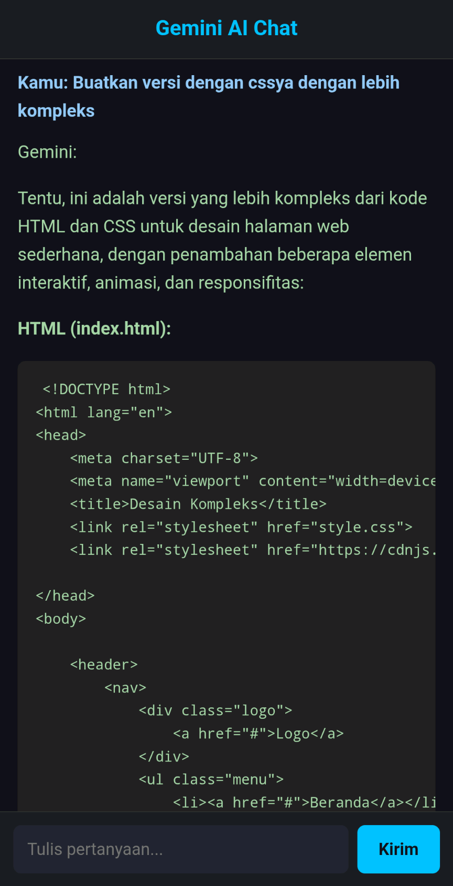

# Gemini ESP32 Web AI Chat

This project turns an ESP32 into a web server that hosts a Gemini API-based chat interface directly from an IoT device. Built with **Arduino IDE**, it lets users interact with Gemini AI over a local network.

## Features

* Turns the ESP32 into a web server (port 80)
* Interactive web interface with a modern UI
* Uses Google's Gemini 2.0 Flash API to process questions
* Supports markdown responses (rendered with `marked.js`)
* Well suited for low-power devices like the ESP32

## Prerequisites

* **ESP32 Board**
* **Arduino IDE** with:

  * ESP32 board support installed ([arduino-esp32](https://raw.githubusercontent.com/espressif/arduino-esp32/gh-pages/package_esp32_index.json))
  * The `WiFi.h` and `WebServer.h` libraries (usually bundled with the ESP32 core)
* An API Key from [Google AI Studio](https://aistudio.google.com)
* An active Wi-Fi connection

## Installation

### Method 1: Clone and open directly

1. **Clone this repository**

   ```bash
   git clone https://github.com/Katryoshkh/Gemini-ESP32-Web-AI-Chat.git
   ```

2. **Open the `.ino` file**

   Open `Gemini-ESP32-Web-AI-Chat/Gemini-ESP32-Web-AI-Chat.ino` in Arduino IDE.

3. **Enter your Wi-Fi credentials & API Key**

   ```cpp
   const char* ssid = "YOUR_SSID";
   const char* password = "YOUR_WIFI_PASSWORD";
   ...
   const API_KEY = "YOUR_API_KEY";
   ```

4. **Upload to the ESP32**

   Make sure the board and port are set correctly in Arduino IDE.

5. **Open the Serial Monitor**

   Once the ESP32 connects to Wi-Fi, open the IP address shown there in your browser.

---

### Method 2: Copy the code manually

1. Create a project folder on your computer, for example:

   ```
   /Gemini-ESP32-Web-AI-Chat/
   ```

2. Create a new file named `Gemini-ESP32-Web-AI-Chat.ino` inside that folder.

3. Copy all the code from the [Gemini-ESP32-Web-AI-Chat](https://github.com/Katryoshkh/Gemini-ESP32-Web-AI-Chat/blob/main/Gemini-ESP32-Web-AI-Chat/Gemini-ESP32-Web-AI-Chat.ino) repo.

4. Open the file with Arduino IDE.

5. Enter your Wi-Fi credentials & API Key as usual.

6. Upload to the ESP32 and check the Serial Monitor, same as Method 1.

## Usage

* Type your prompt in the input field.
* Click the **"Send"** button or press `Enter`.
* The response will be displayed in markdown format.

## Screenshot

*The web interface will look like this:*


## Important Notes

* Use your own personal API Key and do not share it publicly.
* This project **does not host an AI model on the device**; it only acts as an interface to the cloud-based Gemini API.
* Make sure you have a stable internet connection while using it.

## License

MIT License - free to use and modify.
